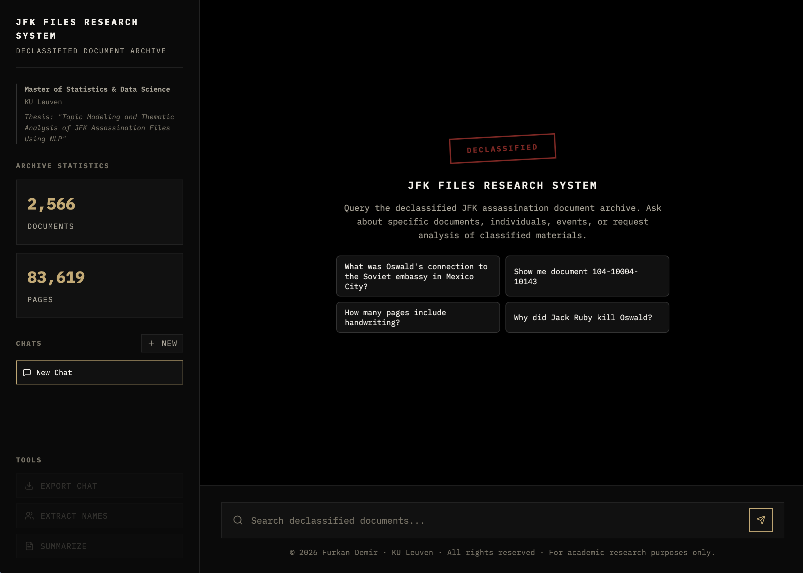

# JFK Files Research System

A Retrieval-Augmented Generation (RAG) system for querying the 2025 declassified JFK assassination record release, built for the Master of Statistics & Data Science thesis at KU Leuven.

> *"Topic Modeling and Thematic Analysis of JFK Assassination Files Using NLP"*

Live: **https://jfk-files.org** (also served at https://jfk-files-rag-production.up.railway.app/)
Thesis repo: https://github.com/furkan-sailpeak/jfk-thesis



## What it does

- **Grounded Q&A** over ~84,000 OCR-processed pages (2,566 documents). Every factual claim carries a `[N]` citation linked to the exact page in the National Archives PDF.
- **Two answer modes** chosen by a router: *simple* (bold lead + bulleted facts) for single-fact questions, *research* (Executive Summary + Detailed Findings) for analytical ones. Timelines and document comparisons come out as tables with a cited row per source.
- **Conversational follow-ups**: pronouns and references ("what about his wife?", "tell me more") are resolved against the last few turns before retrieval.
- **Document lookup**: a record number such as `104-10004-10143` fetches and summarises that whole document.
- **Archive-level questions**: "how many pages have handwriting?" returns exact counts plus cited sample pages.
- **Honest refusals**: questions outside the archive get a fixed refusal line instead of an invented answer.

## Architecture

**Backend:** Python 3.11 · Flask (gunicorn + gevent) · PostgreSQL 15 + pgvector 0.8 (Supabase) · Groq (`gpt-oss-120b` for answers and reranking, `gpt-oss-20b` for routing and checks) · local `BAAI/bge-small-en-v1.5` embeddings (fastembed) · Pydantic · Jinja2.
**Frontend:** React + Vite · Server-Sent Events.
**Deployment:** Docker (Railway in production, docker-compose locally).

### Request pipeline

```
User query
   │
   ├── contains a record number (104-10004-10143) ──► fetch every page of that document, answer from it
   ▼
Router (gpt-oss-20b, JSON)        type ∈ {simple, research, metadata, conversational, out_of_scope};
   │                              rewrites pronouns from history; extracts 1–3 search keywords
   ├── metadata ──────► exact counts from the DB + sample pages
   ├── out_of_scope ──► fixed refusal line
   ├── conversational ► free chat, no retrieval
   ▼
Hybrid retrieval                  full-text (tsvector, keywords; ANDed, OR fallback when thin)
   │                              ∪ vector (bge-small, halfvec(384), HNSW) on the rewritten question
   ▼
Rerank (gpt-oss-120b, strict JSON schema)  keeps the 15 / 20 most substantive pages
   ▼
Generate (gpt-oss-120b, temperature 0)     sources wrapped in <source id="N"> blocks;
   │                                       format reminder at the end of the prompt
   ▼
Grounding check (gpt-oss-20b)     on-subject and supported? if not: expand the query, re-retrieve, regenerate
   ▼
Citation verification (gpt-oss-20b)        per-sentence check of every [N]; a citation on the wrong source
   │                                       is re-pointed to the source that does contain the claim
   ▼
Renumber citations 1..M, stream the final answer (SSE: stage → token → done)
```

The answer is generated in full and checked before anything is streamed, so the user never sees text that later changes.

### Design notes

- **Why hybrid retrieval.** FTS alone missed semantic questions: the pages where Ruby shoots Oswald say *"fired … fatal shot"*, not "killed". The vector leg recovers those; FTS keeps proper-noun precision.
- **Local embeddings.** Queries are embedded in-process with the same model that embedded the corpus, so there is no embedding API to pay for or run out of. The model is baked into the Docker image.
- **One source layout for every model.** The generator, the no-citation retry, the grounding judge and the citation verifier all see identical `<source id="N">` blocks, so a citation means the same thing at every stage.
- **Format reminder at the tail.** Repeating the output format at the end of the prompt halves non-standard citation brackets and keeps simple answers to 2–5 bullets (tested with gpt-oss-120b).
- **Lenient verifier.** A wrongly deleted citation is worse for a researcher than a slightly imprecise one, so the verifier only flags clear mismatches, and re-points rather than deletes where it can.

## Setup

### Prerequisites

- Docker (simplest), or Python 3.11+ and Node.js 20+
- PostgreSQL 15+ with `pgvector ≥ 0.8`
- A [Groq](https://console.groq.com/) API key

```bash
cp .env.example .env   # then fill in DATABASE_URL, GROQ_API_KEY, VITE_SUPABASE_*
```

### Run with Docker

```bash
make up      # build + start on http://localhost:8080 (then start/stop from Docker Desktop)
make logs
make down
```

### Local development without Docker

```bash
make install                 # .venv with app + dev dependencies

# Backend (serves on :5001)
cd rag && ../.venv/bin/python -m app.main

# Frontend, separate terminal (Vite proxies /api → :5001)
cd rag/frontend && npm install && npm run dev
```

### Checks

```bash
make hooks         # install the git pre-commit hook
make check         # pre-commit (ruff, whitespace, yaml…) + pytest
make test          # offline tests only: LLM, embeddings and DB are mocked
make prompt-check  # live: every LLM stage 3× on fixed questions, reports contract + run-to-run consistency (needs `make up`)
```

### Embedding backfill (one-time)

After loading `jfk_pages` from OCR, embed every page so the vector leg has data. A GPU makes this ~20 min instead of ~2.5 h (Apple MPS or CUDA is picked up automatically):

```bash
pip install sentence-transformers psycopg2-binary python-dotenv
python rag/backfill_embeddings_bge.py          # idempotent; resumable
python rag/backfill_embeddings_bge.py --index  # build the HNSW index once
```

The earlier OpenAI embeddings are still in the `embedding` column (`EMBED_PROVIDER=openai` switches back); their backfill script is in `rag/archive/`.

## Deployment and releases

| Branch | Environment | URL |
|---|---|---|
| `main` | production (Railway) | https://jfk-files.org |
| `dev` | staging (Railway) | the staging service's Railway domain |

- **CI** (`.github/workflows/ci.yml`) runs ruff + pytest and a frontend build on every push and PR to `dev`/`main`. Railway's "Wait for CI" holds a deploy until it passes.
- **Releases** (`.github/workflows/release.yml`): every green push to `main` (= a production deploy) gets a GitHub release, tagged by date (`v2026.10.19`, then `v2026.10.19.2` for a second release that day), with notes generated from the commits and PRs since the previous release.
- Ship to production by merging `dev` into `main` (via PR).

## API endpoints

| Endpoint | Method | Description |
|---|---|---|
| `/api/chat` | POST | Answer a question; `{query, history}` in, SSE stream out |
| `/api/stats` | GET | Archive statistics (cached) |
| `/api/analyze` | POST | List the names in, or summarise, a piece of text |
| `/api/pdf/<filename>` | GET | Redirect to the NARA PDF |

## Project layout

```
.
├── rag/
│   ├── app/                     # backend package — read in this order:
│   │   ├── main.py              #   Flask routes
│   │   ├── pipeline.py          #   /api/chat: one function per answer path
│   │   ├── retrieval.py         #   hybrid search, rerank, query expansion, direct lookups
│   │   ├── generation.py        #   router, prompt building, answer generation, citation retry
│   │   ├── verification.py      #   grounding judge, citation verifier
│   │   ├── postprocess.py       #   citation syntax, repair, renumbering (pure functions)
│   │   ├── schemas.py           #   pydantic models for every LLM JSON reply
│   │   ├── llm.py · prompts.py  #   Groq calls; Jinja2 prompt rendering
│   │   └── config.py · db.py · auth.py
│   ├── prompts/                 # prompt templates (Jinja2); archive/ = optimizer history
│   ├── tests/                   # offline pytest suite, one file per module
│   ├── frontend/                # React UI
│   ├── backfill_embeddings_bge.py
│   ├── prompt_check.py          # live prompt consistency check
│   └── Dockerfile
├── admin/                       # architecture diagram, screenshot; eval/, database/ and todo.md are local-only
├── docker-compose.yml · Makefile · pyproject.toml · .pre-commit-config.yaml
└── .env.example
```

`admin/eval/` (the thesis evaluation harness and GEPA prompt-optimisation runs) and `admin/database/` (OCR ingestion scripts) are kept locally but no longer tracked; they are in the git history up to this change. The evaluation numbers were produced with the earlier Llama 3.3 + OpenAI-embedding setup and have not been re-run on the current pipeline.

See [admin/rag-architecture-diagram.html](admin/rag-architecture-diagram.html) for the architecture diagram.

## License

© 2026 Furkan Demir · KU Leuven · All rights reserved · For academic research purposes only.

Academic project, KU Leuven. The JFK records are public domain (NARA, 2025 release). See [LICENSE](LICENSE) for details.
